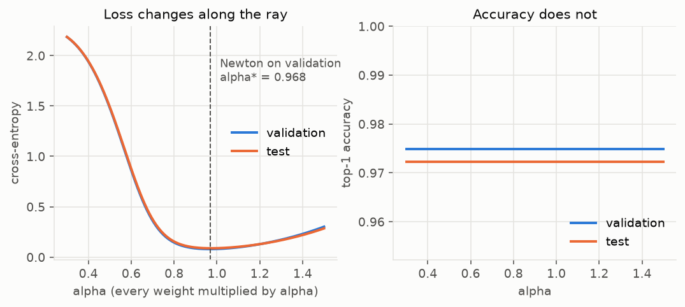
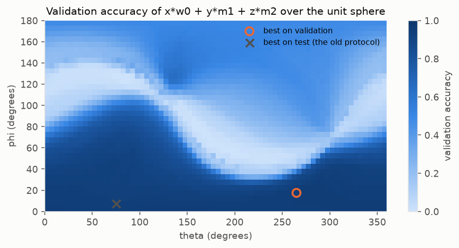

# The Scalar Map Theorem

**Rescale the layers of a ReLU network and its predictions cannot change.** This repository states that fact exactly, proves it in the [Lean 4](https://lean-lang.org) proof assistant, and checks it on trained networks in Python.

- 📄 **Paper:** [`paper/scalar_map_theorem.pdf`](paper/scalar_map_theorem.pdf), which explains it all for humans.
- ✅ **Proofs:** [`lean/`](lean/), machine-checked against Mathlib with no `sorry`. Every theorem uses only Lean's three standard axioms.
- 🧪 **Experiments:** [`python/`](python/), with property tests (71) and three experiments that run in about a minute on a laptop CPU.

## The idea in one paragraph

Call an activation $g$ a **positive scalar map** (PSM) if $g(ax) = s(a)\,g(x)$ for every $a>0$, with $s(a)>0$. Examples:
- ReLU, leaky ReLU, PReLU and $|x|$, all with $s(a)=a$;
- squared ReLU, with $s(a)=a^2$;
- the step function, with $s(a)=1$.

Now multiply layer $i$'s weights by any $c_i>0$:
- **The theorem:** in an MLP with PSM activations and no biases, the logits become $\beta\,f(x)$, where $\beta>0$ is the same number for every input. Softmax preserves the order of the logits, so every example's top-$k$ status is unchanged, and **top-$k$ accuracy is exactly the same, on any dataset**.
- **With biases**, the theorem still holds if bias $i$ is scaled by $c_i$ times the factor that layer $i$'s input picked up. For ReLU that factor is $c_1 \cdots c_{i-1}$, so bias $i$ scales by $c_1 \cdots c_i$.

The loss does change: a bigger $\beta$ means a more confident softmax.

## What is proved (Lean name → statement)

| Lean | Statement |
|---|---|
| `IsPSM` | Definition of a positive scalar map |
| `relu_isPSM`, `leakyReLU_isPSM`, `abs_isPSM`, `reluPow_isPSM`, `heaviside_isPSM` | These activations are PSMs |
| `IsPSM.scale_mul`, `IsPSM.scale_one` | $s(ab)=s(a)s(b)$ and $s(1)=1$ (so, with regularity, $s(a)=a^p$) |
| `IsPSM.deg1_iff` | The PSMs with $s(a)=a$ are **exactly** $p\max(x,0)-q\max(-x,0)$, so no smooth nonlinear activation has degree 1 |
| `Net.scalar_map_theorem` | **Theorem 1:** bias-free network, per-layer scaling: logits × one $\beta>0$ |
| `Net.scalar_map_theorem_bias` | **Theorem 2:** the same with biases, under the telescoping bias rule |
| `inTopK_smul`, `inTopK_softmax`, `inTopK_softmax_smul` | Top-$k$ membership ignores positive scaling and softmax |
| `Net.topK_count_scaleW`, `Net.topK_count_scale`, `Net.topK_softmax_scale` | Top-$k$ accuracy on any finite dataset is unchanged |
| `Net.eval_scaleW_deg1`, `Net.eval_scaleW_const` | Degree 1: $\beta = \prod c_i$; scaling every weight by $\alpha$ gives $\alpha^{\text{depth}}$ |
| `Net.neuron_rescale` | Degree 1: rescaling **one hidden unit** (in by $d$, out by $1/d$) leaves the network exactly unchanged |

The networks are general:
- arbitrary depth and widths;
- vectors are `Fin n → ℝ` and weights are Mathlib `Matrix`es;
- each layer can have its own activation.

Lean does not check:
- that cross-entropy is convex in the logit scale (the proof is in the paper);
- that GELU, tanh and similar activations are not PSMs (checked numerically).

## Results (scikit-learn digits, `64-100-100-100-10` MLPs)

**Invariance.** The table shows the range of test accuracy over 200 random per-layer scalings, each $c_i$ log-uniform in $[0.1, 10]$:

| Network and scaling rule | top-1 range | top-3 range |
|---|---|---|
| Leaky ReLU, no bias (Theorem 1) | **0** | **0** |
| ReLU, no bias (Theorem 1) | **0** | **0** |
| ReLU + biases, telescoping rule (Theorem 2) | **0** | **0** |
| ReLU² + biases, telescoping rule (Theorem 2, $s(a)=a^2$) | **0** | **0** |
| ReLU + biases, naive rule ($b_i \mapsto c_i b_i$) | 0.733 | 0.525 |
| ReLU + biases, every parameter × α | 0.900 | 0.617 |
| GELU / tanh / softplus, no bias | 0.194 / 0.033 / 0.861 | 0.011 / 0.006 / 0.706 |

Where a theorem applies, the logits match $\beta f(x)$ to a relative error of about $10^{-15}$. Per-unit rescaling changes no logit by more than $1.4\times10^{-14}$.

**The ray.** Along $\alpha\theta$, accuracy is a flat line, and cross-entropy is convex in $t=\alpha^L$. The best scale is therefore found exactly by Newton's method (temperature scaling), instead of the old 400-point grid search.



**Slices.** For a bias-free network, the closed curve $\cos(s)u + \sin(s)v$ shows the accuracy of the *whole plane* spanned by $u$ and $v$, because every ray in the plane crosses the curve once. A sphere does the same for three vectors. The old notebook picked the best point on the sphere **using the test set**:

| Protocol, mean of 5 seeds | Test accuracy |
|---|---|
| Final trained network | 0.961 |
| Sphere point chosen on **validation** | 0.960 |
| Sphere point chosen on **test** (old protocol) | 0.968 |

Choosing on test overstated accuracy by 0.8 points.



## Reproduce

**Lean** (needs [elan](https://github.com/leanprover/elan); the first build downloads the Mathlib cache):
```bash
cd lean
lake exe cache get      # prebuilt Mathlib
lake build              # checks every proof
lake env lean Axioms.lean   # prints the axioms each headline theorem uses
```

**Python** (numpy, scikit-learn, matplotlib, pytest):
```bash
cd python
pip install -r requirements.txt
pytest -q                      # 71 property tests
python experiments/run_all.py  # writes results/*.json and results/*.png
```

**Paper:** `cd paper && tectonic scalar_map_theorem.tex` (or `pdflatex`).

## Layout

```
lean/ScalarMap/Activation.lean   PSMs: definition, structure, examples
lean/ScalarMap/Order.lean        top-k membership, softmax
lean/ScalarMap/Network.lean      networks, Theorems 1 and 2, accuracy corollaries
lean/ScalarMap/Neuron.lean       per-unit rescaling
python/scalar_map/               NumPy MLP (float64), the scalings, Newton temperature solve
python/tests/                    the theorems as property tests
python/experiments/              exp1 invariance, exp2 ray, exp3 slices
results/                         experiment outputs (committed)
paper/                           the write-up
legacy/                          the original notebook and earlier drafts
```

## Prior work

The rescaling symmetry of ReLU networks is well known: Neyshabur et al. 2015 (Path-SGD), Dinh et al. 2017, Laurent & von Brecht 2018, Lyu & Li 2020, and Kunin et al. 2021. The new parts here are:
- the exact statement for general PSMs, with the bias rule;
- the formal proofs;
- the two uses of the theorem: the convex 1-D loss along a ray, and complete accuracy slices.

The paper's related-work section has details.
